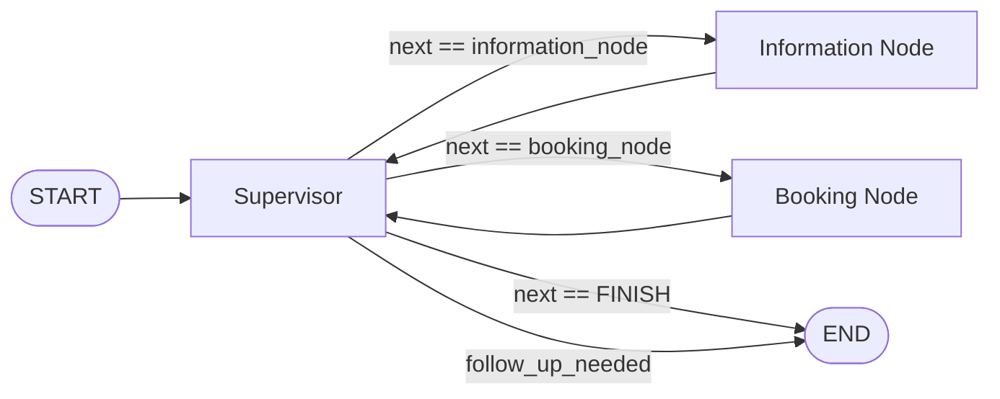

# 🩺 MedGraph Scheduler
## Langgraph Doctor Appointment Assistant

A sophisticated AI-powered healthcare scheduling system that uses LangGraph's multi-agent architecture to handle doctor appointments intelligently. The system combines a supervisor agent pattern with specialized nodes for information retrieval and booking management.

## 🌐 Live Demo

- Try the live application: http://100.26.102.139:8501
- The system is currently deployed on AWS EC2 and ready for testing. 
- Simply enter a user ID (e.g., 1234567) and start chatting with the AI assistant!

## 🚀 What This Project Is

The Doctor Appointment Assistant is an intelligent conversational agent that helps dental patients:
- Check doctor availability by name or specialization
- Book new appointments
- Cancel existing appointments
- Reschedule appointments
- Get information about the available dental services

> The bundled dataset only covers dental specializations (general, cosmetic, pediatric, emergency, prosthodontist, oral surgeon, orthodontist), so queries about other medical fields will not match any data.

The system uses natural language processing to understand user requests and automatically routes them to the appropriate specialized agent for handling.

## 🧠 Key Concepts & Technologies

### **LangGraph Multi-Agent Architecture**
- **Supervisor Agent Pattern**: Central coordinator that routes requests to specialized nodes
- **State Management**: Persistent conversation state across interactions
- **Conditional Routing**: Dynamic decision-making based on user intent

### **Agent Specialization**
- **Information Node**: Handles availability queries and general information
- **Booking Node**: Manages appointment operations (set, cancel, reschedule)
- **Tool Integration**: Each node has access to specific tools for their domain

### **Memory & Persistence**
- Thread-based conversation memory using LangGraph's MemorySaver
- CSV-based data persistence for appointment scheduling
- Session state management in the frontend

## 🏗️ System Architecture

```
┌─────────────────┐    ┌──────────────────┐    ┌─────────────────┐
│  Streamlit UI   │◄──►│   FastAPI        │◄──►│   LangGraph     │
│  (Frontend)     │    │   (Backend)      │    │   Agent         │
└─────────────────┘    └──────────────────┘    └─────────────────┘
                                                         │
                                                         ▼
                                   ┌─────────────────────────────────┐
                                   │       Supervisor Node           │
                                   │   (Routes based on intent)      │
                                   └─────────────────┬───────────────┘
                                                     │
                                        ┌────────────┴────────────┐
                                        ▼                         ▼
                                ┌───────────────┐        ┌──────────────┐
                                │ Information   │        │  Booking     │
                                │    Node       │        │   Node       │
                                │               │        │              │
                                │ • Check       │        │ • Set appt   │
                                │   availability│        │ • Cancel     │
                                │ • Doctor info │        │ • Reschedule │
                                └───────────────┘        └──────────────┘
                                        │                         │
                                        ▼                         ▼
                                ┌───────────────────────┐  ┌─────────────────────────┐
                                │   Tools:              │  │   Tools:                │
                                │ • check_availability_ │  │ • set_appointment       │
                                │   by_doctor           │  │ • cancel_appointment    │
                                │ • check_availability_ │  │ • reschedule_appointment│
                                │   by_specialization   │  │                         │
                                └───────────────────────┘  └─────────────────────────┘
```

## 🛠️ Tools & Technologies

### **Backend Stack**
- **FastAPI**: REST API framework for handling HTTP requests
- **LangGraph**: Multi-agent workflow orchestration
- **LangChain**: LLM integration and tool management
- **Pydantic**: Data validation and serialization
- **Pandas**: Data manipulation for appointment records

### **Frontend Stack**
- **Streamlit**: Interactive web interface
- **Session Management**: Persistent chat history and user state

### **AI/ML Stack**
- **LLM Integration**: OpenAI `gpt-4o` via `langchain-openai` (see [utils/llms.py](utils/llms.py)). The Groq client is installed as a dependency but not currently wired into the agent.
- **Structured Output**: Type-safe LLM responses using Pydantic models
- **Tool Calling**: Function calling capabilities for database operations

### **Data Storage**
- **CSV Database**: Simple file-based storage for appointment data
- **In-Memory State**: LangGraph memory saver for conversation persistence

## 📊 Data Structure

The system uses a CSV-based database (`doctor_availability.csv`) with the following structure:

```csv
date_slot,specialization,doctor_name,is_available,patient_to_attend
05-08-2025 08:00,general_dentist,john doe,True,
05-08-2025 08:30,general_dentist,john doe,False,1000082.0
05-08-2025 09:00,general_dentist,john doe,False,1000048.0
05-08-2025 09:30,general_dentist,john doe,False,1000036.0
05-08-2025 10:00,general_dentist,john doe,False,1000024.0
05-08-2025 10:30,general_dentist,john doe,False,1000011.0
05-08-2025 11:00,general_dentist,john doe,False,1000061.0
```

### **Available Doctors**
- John Doe, Jane Smith, Emily Johnson, Michael Green, Sarah Wilson, Daniel Miller, Susan Davis, Robert Martinez, Lisa Brown, Kevin Anderson

### **Specializations**
- General Dentist, Cosmetic Dentist, Prosthodontist, Pediatric Dentist, Emergency Dentist, Oral Surgeon, Orthodontist

## 🔄 Behind the Scenes - Agent Workflow

The agent is a two-tier LangGraph: a **structured-output supervisor** sits on top of two **ReAct-style worker nodes**. Control always loops back to the supervisor after a worker turn, so the supervisor is the only node that can end the run.

### **High-level control flow**



The graph is built in [agent.py](agent.py) as a `StateGraph(AgentState)` with three nodes — `supervisor`, `information_node`, `booking_node` — `START → supervisor` as the only fixed edge, and `MemorySaver` as the checkpointer keyed off `thread_id`.

### **1. Supervisor Node — structured-output router**

The supervisor is **not** a ReAct agent. It is a single LLM call that is forced to return a typed payload via `with_structured_output(Router)`:

```python
class Router(TypedDict):
    next: Literal["information_node", "booking_node", "FINISH"]
    reasoning: str

router_response = self.llm_model.with_structured_output(Router).invoke(router_messages)
```

On each invocation it:
1. Checks `state["follow_up_needed"]`. If true, the previous worker asked the user a clarifying question, so the graph ends the turn (`Command(goto="__end__", ...)`) and waits for the next user message.
2. Otherwise it builds a routing prompt — the system prompt from [prompt_library/prompt.py](prompt_library/prompt.py) (which lists the available workers and the FINISH rules) plus the full message history — and asks the LLM to pick the next node.
3. Emits a `Command(goto=next_node, update={"next": ..., "query": ..., "current_reasoning": ...})`. `FINISH` is mapped to LangGraph's `END` sentinel.

Example router payload:

```json
{
  "next": "information_node",
  "reasoning": "User wants to check availability for a specific doctor."
}
```

### **2. Information Node — ReAct agent over availability tools**

Built with LangGraph's prebuilt ReAct loop:

```python
info_agent = create_react_agent(
    model=self.llm_model,
    tools=[check_availability_by_doctor, check_availability_by_specialization],
    prompt=agent_prompt,
)
```

`create_react_agent` runs the standard **Reason → Act → Observe** cycle: the model thinks, optionally emits a tool call, the tool's output becomes a `ToolMessage`, and the loop repeats until the model produces a final answer. The system prompt injects the user's `id_number` so the model never re-asks for it and pins the year to 2025 so date parsing into `DD-MM-YYYY` is consistent.

Tool surface (from [toolkit/toolkits.py](toolkit/toolkits.py)):
- `check_availability_by_doctor(desired_date: DateModel, doctor_name: Literal[...])` — reads `data/doctor_availability.csv`, filters to the requested doctor and date, returns the free time slots.
- `check_availability_by_specialization(desired_date: DateModel, specialization: Literal[...])` — same but grouped by doctor for a given specialization, with times rendered in 12-hour AM/PM.

After the ReAct loop finishes, the node appends the final assistant message to `state["messages"]` (tagged `name="information_node"`) and returns `Command(goto="supervisor", ...)`, handing control back to the router.

### **3. Booking Node — ReAct agent over write tools**

Same shape as the information node but with the appointment-mutation tools:

```python
booking_agent = create_react_agent(
    model=self.llm_model,
    tools=[set_appointment, cancel_appointment, reschedule_appointment],
    prompt=agent_prompt,
)
```

Tools (from [toolkit/toolkits.py](toolkit/toolkits.py)):
- `set_appointment(desired_date: DateTimeModel, id_number: IdentificationNumberModel, doctor_name)` — finds the matching free slot, marks `is_available=False`, writes the patient ID back to CSV.
- `cancel_appointment(desired_date, id_number, doctor_name?)` — looks up the patient's booking; if the doctor name is omitted and there is exactly one match for that day it cancels it, otherwise it lists candidates and asks which to cancel.
- `reschedule_appointment(old_date, new_date, id_number, doctor_name)` — verifies the new slot is free, then internally invokes `cancel_appointment` followed by `set_appointment`.

All three rely on the Pydantic models in [data_models/models.py](data_models/models.py) for input validation: `DateModel` (`DD-MM-YYYY`), `DateTimeModel` (`DD-MM-YYYY HH:MM`), and `IdentificationNumberModel` (7–8 digit integer).

### **4. State management**

Every node reads and writes the same `AgentState` TypedDict from [agent.py](agent.py):

```python
class AgentState(TypedDict):
    messages: Annotated[list[Any], add_messages]  # full chat history (LangChain messages)
    id_number: int                                # patient ID, set by FastAPI from the request
    next: str                                     # router's last decision
    query: str                                    # latest user utterance
    current_reasoning: str                        # router's reasoning for the last hop
    follow_up_needed: bool                        # set by workers when the model didn't call a tool
```

The `messages` field uses LangGraph's `add_messages` reducer, so each node's update is appended rather than replacing history, and the `MemorySaver` checkpointer persists the entire state per `thread_id` between turns.

### **5. The `follow_up_needed` gate**

After each worker run, the node sets `follow_up_needed = not tool_was_used`. The intent is: "if the model produced a final answer without calling a tool, it must be asking the user for more information, so end the turn instead of looping through the supervisor again." On the next user turn the supervisor sees the flag, clears it, and ends immediately so the new user message can be processed fresh.

> ⚠️ Implementation caveat: the current detection uses `getattr(msg, "role", None) == "tool"`, but LangChain `ToolMessage` objects expose `.type == "tool"` rather than a `role` attribute, so `tool_was_used` is effectively always `False` and `follow_up_needed` is always `True` after a worker step. In practice this means the supervisor ends the turn after every worker hop, which is close to (but not exactly) the intended behavior.

## 🔄 Behind the Scenes - Frontend/Backend Flow

### **Request Flow**
1. **User Input**: User types message in Streamlit chat interface
2. **Validation**: System checks for required user ID
3. **API Call**: POST request to FastAPI `/execute` endpoint
4. **Agent Invocation**: FastAPI triggers LangGraph agent with user state
5. **Processing**: Agent routes through supervisor → specialized node → tools
6. **Response**: Agent returns updated state with AI response
7. **UI Update**: Streamlit displays response and updates chat history

### **Session Management**
- **Thread ID**: Unique identifier for conversation persistence
- **User ID**: Patient identification for appointment management
- **Message History**: Maintained both in frontend and agent memory

### **Error Handling**
- Network timeouts with user-friendly messages
- Database operation failures with graceful degradation
- Input validation at multiple layers

## 🏃‍♂️ How to Run Locally

### **Prerequisites**
- Python 3.10 or newer (per [setup.py](setup.py))
- pip package manager

### **Installation Steps**

1. **Clone the repository**
```bash
git clone https://github.com/aaditey932/langgraph-doctor-appointment-agent-system.git
cd langgraph-doctor-appointment-agent-system
```

2. **Install dependencies**
```bash
pip install -r requirements.txt
```

3. **Set up environment variables**
Create a `.env` file in the root directory:
```env
OPENAI_API_KEY=your_openai_api_key_here
```

4. **Prepare the data**
Ensure `data/doctor_availability.csv` exists with proper format

5. **Start the FastAPI backend**
```bash
uvicorn main:app --host 127.0.0.1 --port 8003 --reload
```

6. **Launch the Streamlit frontend**
```bash
streamlit run streamlit_ui.py
```

7. **Access the application**
Open your browser and navigate to `http://localhost:8501`

### **Testing the System**
- Enter a 7- or 8-digit user ID (e.g., 1234567) in the sidebar; this is enforced by `IdentificationNumberModel` in [data_models/models.py](data_models/models.py).
- Try queries like:
  - "Check availability for Dr. John Doe on 15-08-2025"
  - "I need to book an appointment with a general dentist on 15-08-2025 at 09:00"
  - "Cancel my appointment with Dr. John Doe on 16-08-2025 at 10:00"

> Tool inputs use **DD-MM-YYYY** dates and **DD-MM-YYYY HH:MM** datetimes (validated by `DateModel` and `DateTimeModel` in [data_models/models.py](data_models/models.py)). The agent's prompts ask the LLM to translate natural-language dates into this format, but providing them directly is the most reliable.

## 🚀 Deployment Details

### **AWS EC2 Configuration**
- **Instance Type**: t2.micro (1 GiB RAM, 1 vCPU) — sufficient for the demo workload
- **Operating System**: Linux (Amazon Linux 2 or Ubuntu)
- **Storage**: 8GB+ SSD

## 📝 Usage Examples

### **Check Availability**
```
User: "Is Dr. John Doe available on 15-08-2025?"
System: "Let me check Dr. John Doe's availability for 15-08-2025..."
```

### **Book Appointment**
```
User: "Book me with a general dentist on 18-08-2025 at 14:00"
System: "I'll help you book that appointment. Let me check availability..."
```

### **Cancel Appointment**
```
User: "Cancel my appointment with Dr. John Doe on 15-08-2025 at 09:00"
System: "I'll help you cancel your appointment. Let me find your booking..."
```

## 🤝 Contributing

1. Fork the repository
2. Create a feature branch (`git checkout -b feature/new-feature`)
3. Commit your changes (`git commit -am 'Add new feature'`)
4. Push to the branch (`git push origin feature/new-feature`)
5. Create a Pull Request
